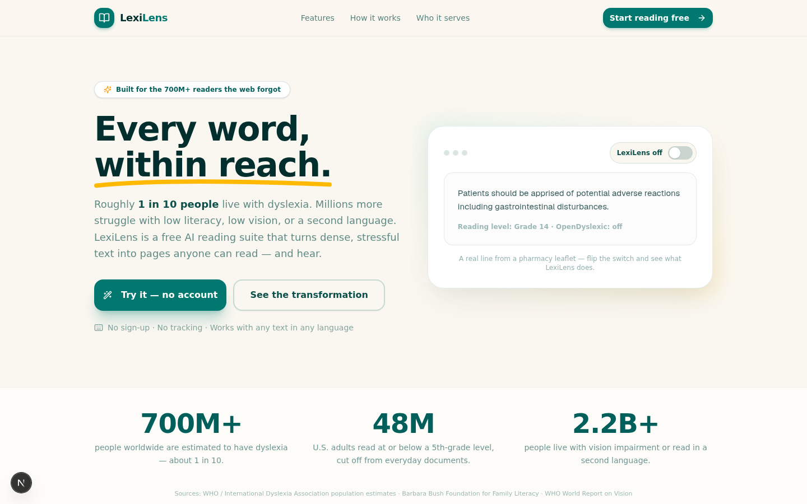
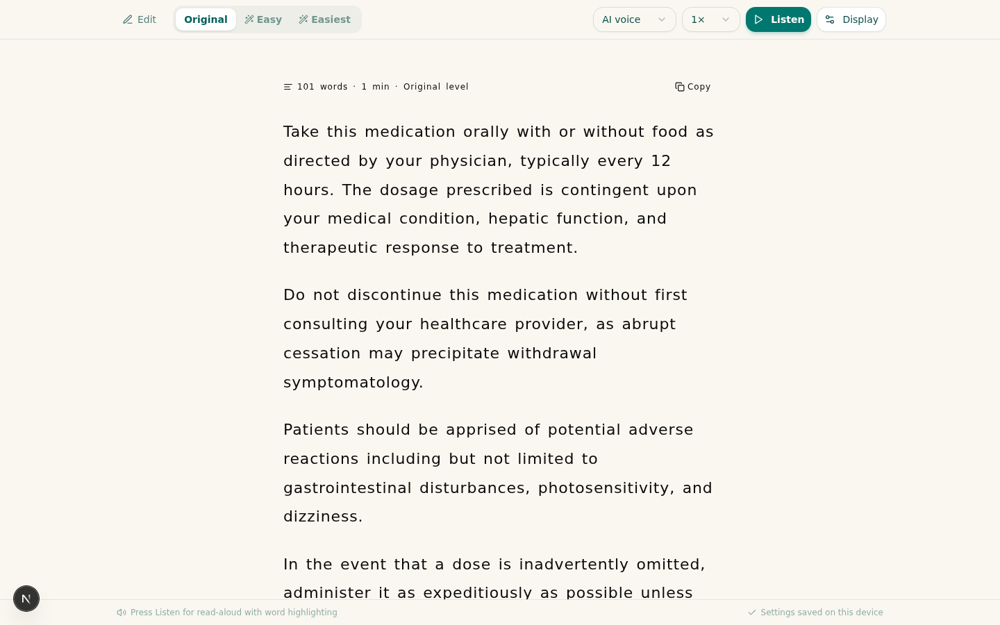
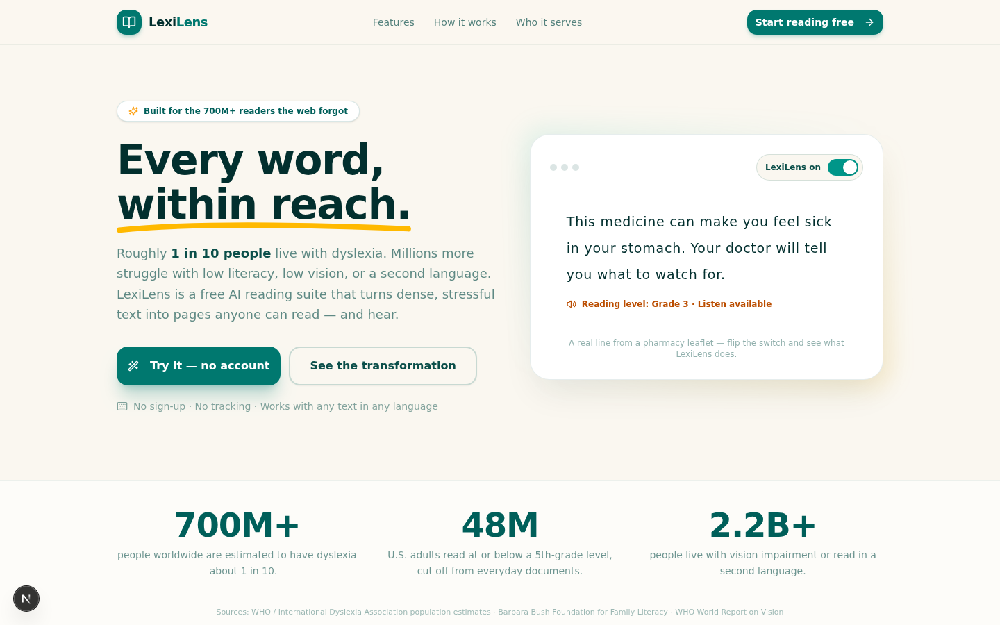
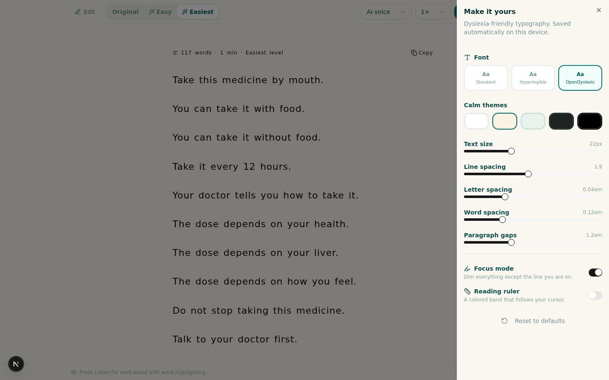
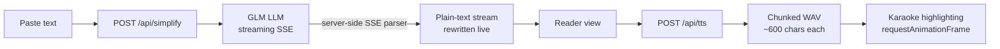

<div align="center">


# LexiLens

**See words differently.**

A free, private, no-account AI reading suite that turns dense, hard-to-read text into pages anyone can read — and hear.

Built for **NextSpark Hacks 2026** · [Demo Video](docs/demo/lexilens_demo.mp4)

</div>

---

## 🎯 The problem

**1 in 10 people worldwide live with dyslexia** — over 700 million people. In the U.S. alone, **48 million adults read at or below a 5th-grade level**. Add low vision, aging eyes, and the billions reading in a second language, and a huge population is locked out of everyday text.

The worst part? The most important documents are the hardest to read:

> 🏥 *"Patients should be apprised of potential adverse reactions including gastrointestinal disturbances."*
> 🏠 *"Lessee hereby covenants and agrees to indemnify, defend, and hold harmless Lessor…"*

If you read fluently, you never notice. If you don't, this language is a wall between you and your own health, housing, and rights.

## ✨ What LexiLens does

Paste any hard text (or load a real-world sample — prescription label, lease clause, terms of service), then:

| | Feature | What it does |
|---|---------|--------------|
| 🧠 | **AI Text Simplification** | One tap rewrites text at an *Easy* (Grade 5-6) or *Easiest* (Grade 2-3) reading level, streamed live word-by-word. Facts, numbers, and names are preserved. |
| 🔤 | **Dyslexia-friendly typography** | Self-hosted **OpenDyslexic** & **Atkinson Hyperlegible** fonts, adjustable text size, line height, letter/word spacing, paragraph gaps. |
| 🎨 | **Calm reading themes** | Paper, cream, mint, night, and high-contrast — because harsh white pages are a barrier, not a neutral choice. |
| 🔊 | **Read-aloud karaoke** | Natural AI voice (chunked TTS, first words in ~2s) or instant browser voice reads while **each word glows as it's spoken**. Double-click any word to hear it alone. |
| 🎯 | **Focus mode & reading ruler** | Dims everything except the active paragraph; an optional translucent ruler band follows the cursor. |
| 🔒 | **Private by design** | No account, no tracking, nothing stored server-side. Settings live in localStorage. |

**Before:** *"Administer it as expeditiously as possible unless the subsequent scheduled dose is imminent."*
**After:** *"If your next dose is close, skip the missed dose."* Same facts. Different world.

## 📸 Screenshots

| Landing | Reader (original) |
|:---:|:---:|
|  |  |

| Interactive demo | Easiest mode + settings |
|:---:|:---:|
|  |  |

## 🏗️ How it's built

**Next.js 16 (App Router) + TypeScript + Tailwind CSS 4 + shadcn/ui + Framer Motion**, with two AI-powered API routes backed by the GLM large language model (`z-ai-web-dev-sdk`):



- **Streaming simplification** — `/api/simplify` calls GLM with `stream: true`, parses the raw SSE byte stream server-side (with buffering for partial frames), and re-streams plain text so users watch the rewrite happen word by word. Two engineered system prompts enforce fact preservation, short sentences, and paragraph breaks at each reading level.
- **Low-latency read-aloud** — `/api/tts` generates WAV audio via the SDK. The client splits text into ~600-char chunks, plays chunk 0 as soon as it arrives, and pre-fetches the next during playback — cutting time-to-first-audio from ~15s to ~2s. A `requestAnimationFrame` loop maps audio progress onto a length-weighted word index for the karaoke glow; a browser `SpeechSynthesis` fallback (with word-boundary events) covers offline use.
- **Typography engine** — CSS custom properties drive five reading themes; `@font-face` rules self-host the dyslexia-friendly fonts so the app works even if font CDNs are blocked.
- **Accessibility-first UI** — semantic HTML, ARIA labels on every control, keyboard-navigable focus states, `prefers-reduced-motion` support, 44px+ touch targets, fully responsive mobile-first layout.

## 🚀 Quick start

**Prerequisites:** [Node.js 20+](https://nodejs.org/) or [Bun](https://bun.sh), and a Z.AI API config for the AI features.

```bash
# 1. Install dependencies
npm install        # or: bun install

# 2. Configure the AI SDK (see .z-ai-config.example)
cp .z-ai-config.example .z-ai-config
#    then fill in your baseUrl + apiKey

# 3. Run
npm run dev        # or: bun run dev
#    open http://localhost:3000
```

> The app degrades gracefully: without a valid `.z-ai-config`, simplification and AI read-aloud are unavailable, but dyslexia typography, themes, focus mode, reading ruler, and browser read-aloud all still work.

## 🛠️ Challenges we ran into

1. **Streaming parse** — the LLM SDK's streaming response is raw SSE byte chunks, not parsed JSON. We built a server-side SSE parser with buffering for partial frames.
2. **Audio latency** — one TTS file for a whole page took 15+ seconds before sound. Chunked generation + prefetching cut time-to-first-audio to ~2 seconds.
3. **Karaoke sync** — no word-level timing in generated audio. We approximate word boundaries by weighting each word's share of total characters.
4. **Font availability** — dyslexia-specific fonts aren't on standard CDNs in every region, so we self-host them as binary assets.

## 📁 Project structure

```
src/
├── app/
│   ├── api/
│   │   ├── simplify/route.ts   # LLM streaming text simplification
│   │   └── tts/route.ts        # AI text-to-speech (WAV)
│   ├── layout.tsx              # Metadata, fonts, toaster
│   └── page.tsx                # Landing + Reader
├── components/
│   ├── lexilens/
│   │   ├── Landing.tsx         # Hero, interactive demo, problem/solution
│   │   ├── Reader.tsx          # The reading workspace (950 lines)
│   │   └── types.ts
│   └── ui/                     # shadcn/ui components
├── hooks/                      # use-mobile, use-toast
└── lib/utils.ts
public/fonts/                   # Self-hosted OpenDyslexic, Atkinson, Lexend
docs/                           # Screenshots + demo video
```

## 📜 License

[MIT](LICENSE) — free forever, for everyone who reads differently.

---

<div align="center">
<sub>Built with ❤️ for the 700M+ people who read differently.</sub>
</div>
